# Capturas: antes y después

Antes: `main` (d130878), en `antes/shots/`. Después: rama `claude/portfolio-refresh` tras la revisión final, en `despues/shots/`. Primera pantalla de cada versión; debajo de cada tabla, la página completa.

En la versión anterior `/ca` y `/en` no existían: catalán e inglés se cargaron en `/` con el idioma forzado.

## Móvil, 375 px

| | Antes | Después |
|---|---|---|
| Castellano | 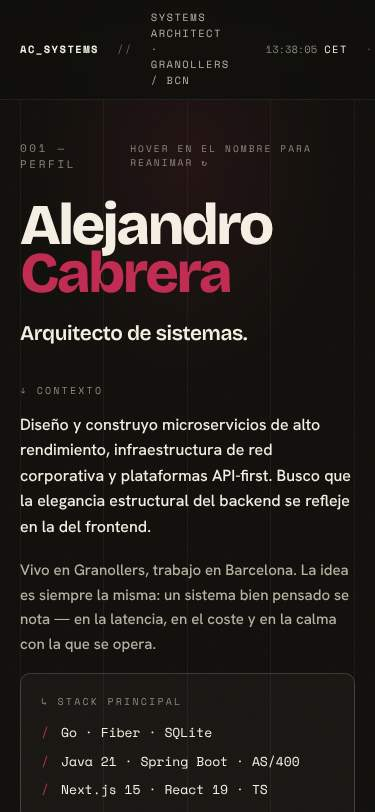 | 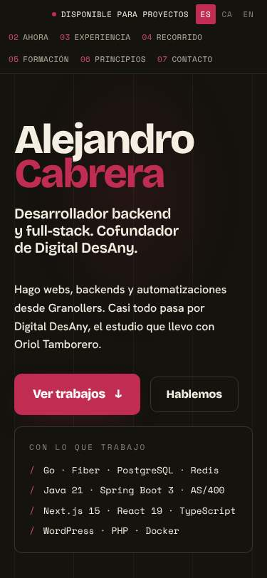 |
| Català | 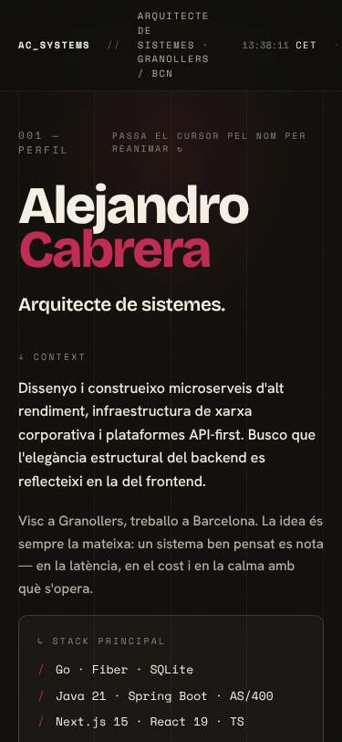 | 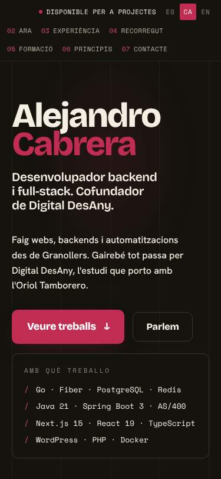 |
| English | 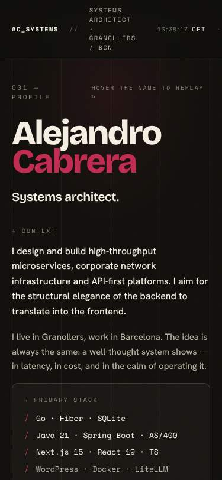 | 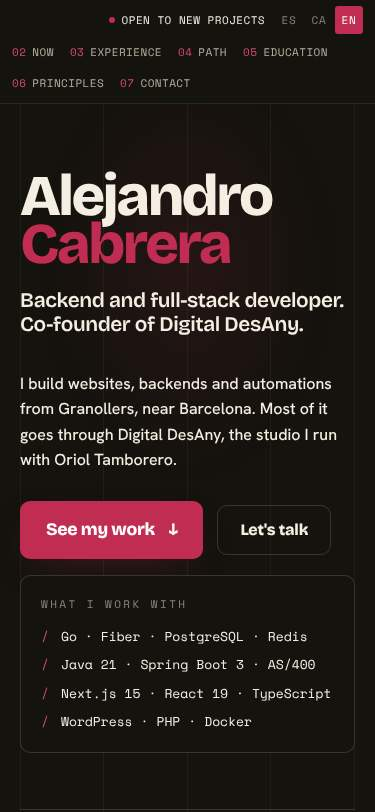 |

Páginas completas: [antes es](antes/shots/es-375-full.jpg) · [después es](despues/shots/es-375-full.jpg) · [antes ca](antes/shots/ca-375-full.jpg) · [después ca](despues/shots/ca-375-full.jpg) · [antes en](antes/shots/en-375-full.jpg) · [después en](despues/shots/en-375-full.jpg)

## Escritorio, 1440 px

| | Antes | Después |
|---|---|---|
| Castellano | 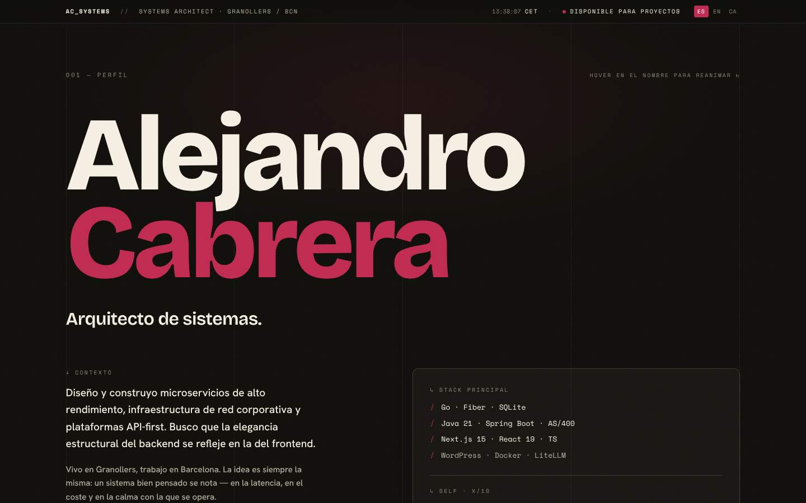 | 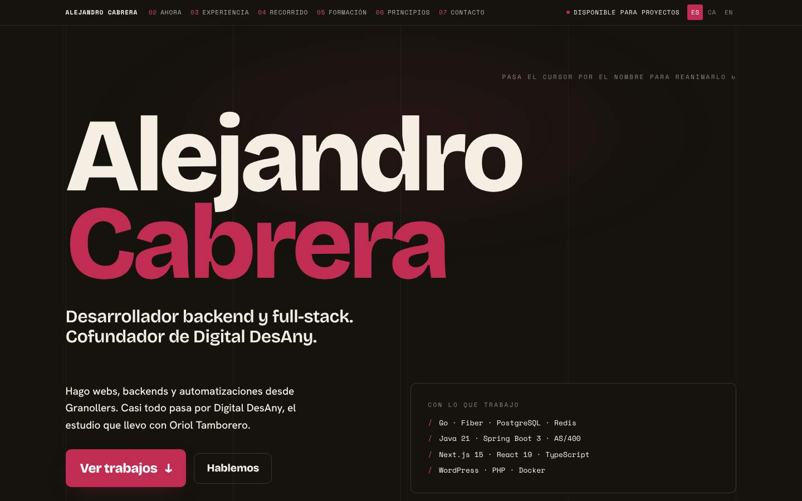 |
| Català | 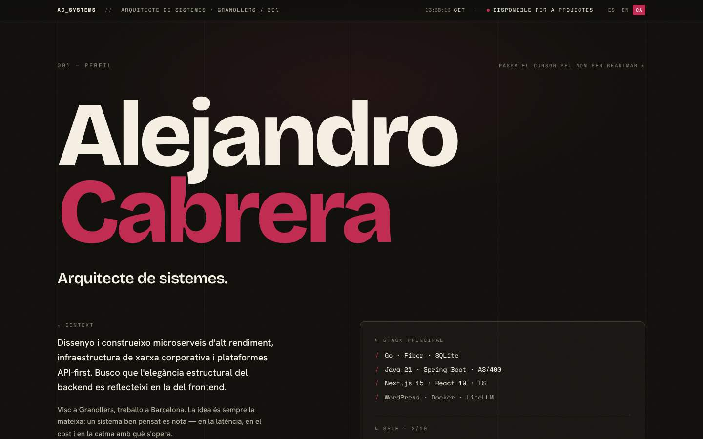 | 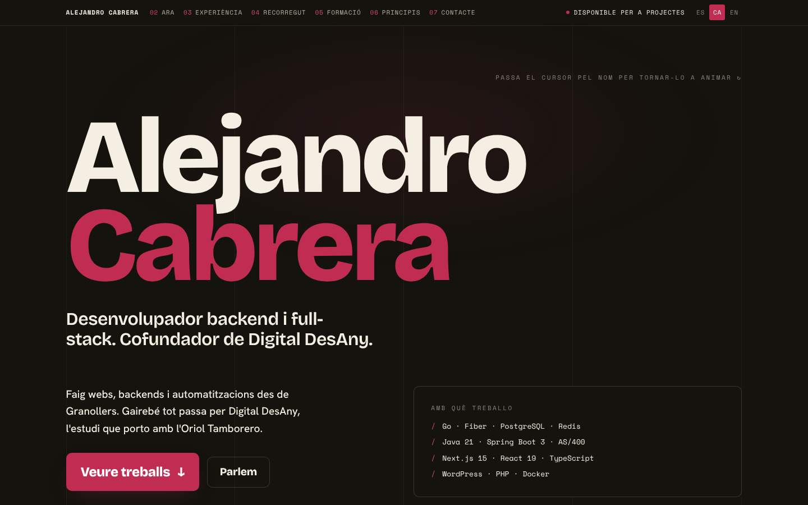 |
| English |  | 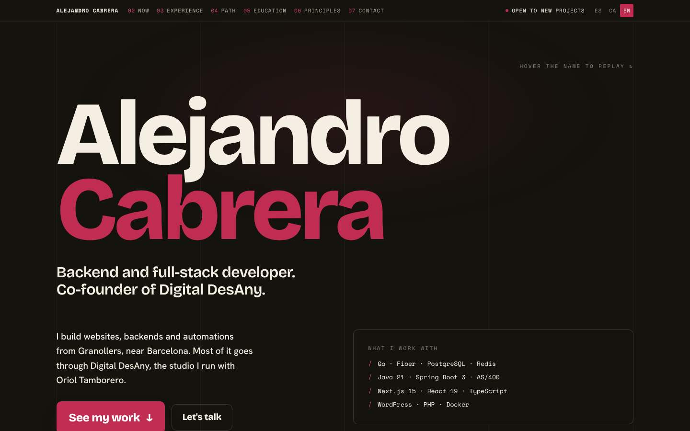 |

Páginas completas: [antes es](antes/shots/es-1440-full.jpg) · [después es](despues/shots/es-1440-full.jpg) · [antes ca](antes/shots/ca-1440-full.jpg) · [después ca](despues/shots/ca-1440-full.jpg) · [antes en](antes/shots/en-1440-full.jpg) · [después en](despues/shots/en-1440-full.jpg)

## Imagen OG

Una por idioma, con Bricolage Grotesque cargada desde archivo, el nombre, el título nuevo y el dominio.

| Castellano | Català | English |
|---|---|---|
|  |  |  |
