# Textos antes y después (capa de marketing)

Cada texto visible que cambió el 22 de octubre de 2026 (y, al final, los de Sobre mí y las respuestas de digitaldesany.com del 23), con su ruta en `lib/content.ts` o `lib/pages.ts` y las técnicas de `../MARKETING.md` que aplica. Primero el castellano de antes y de después; debajo, el catalán y el inglés nuevos. Los textos que no aparecen aquí no cambian. Incluye los arreglos de la revisión final.

Antes (izquierda) y después (derecha), en castellano:

| Inicio, 1440 px | Inicio, 375 px |
|---|---|
| 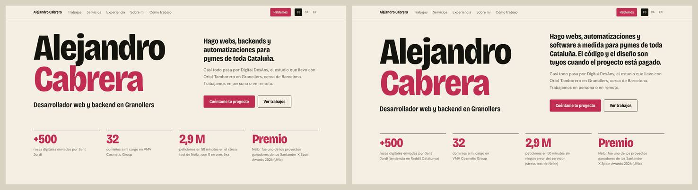 | 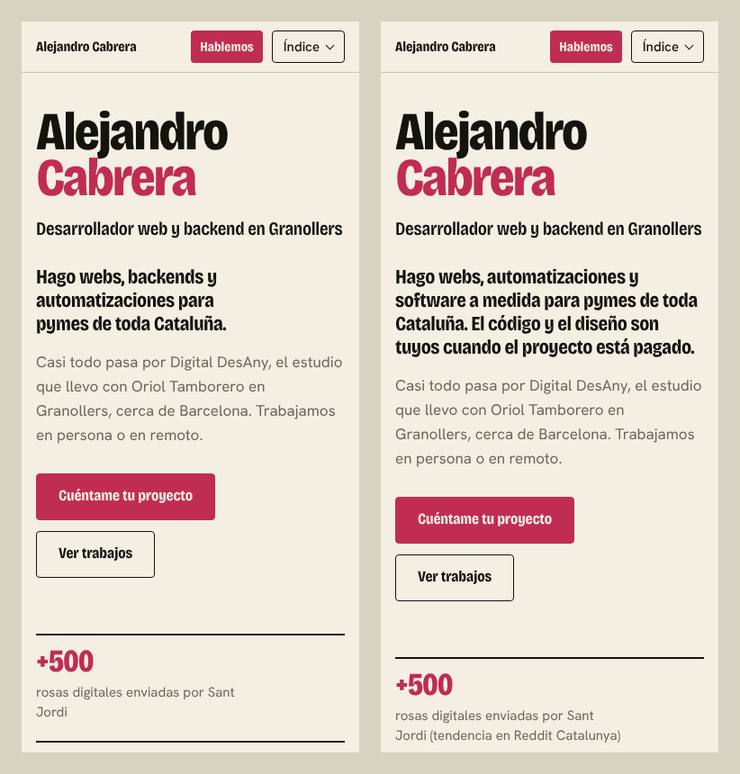 |

| Servicios, 1440 px | Contacto, 375 px |
|---|---|
| 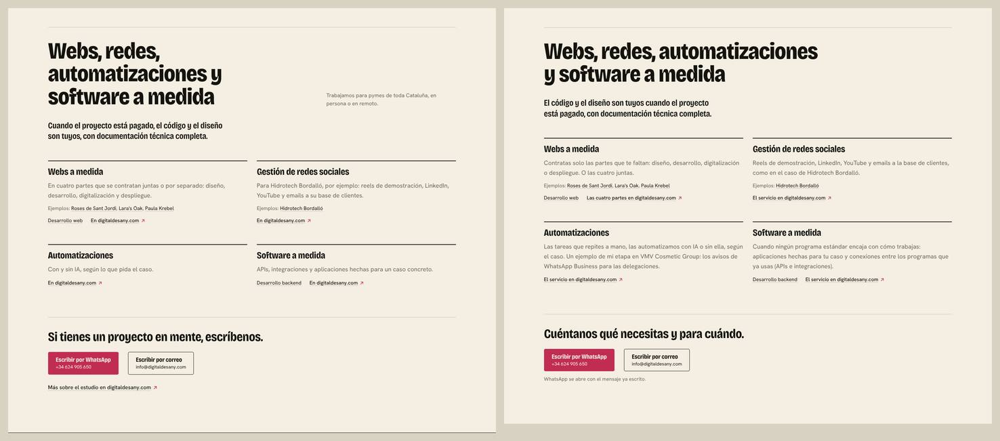 | 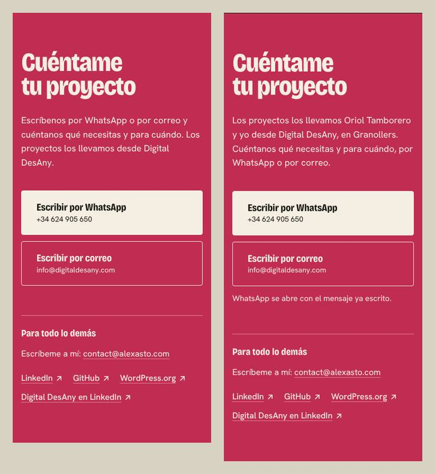 |

55 textos cambiados, añadidos o quitados.

### `DATA.hero.lead` (T1, T3, T5)

- **Antes:** Hago webs, backends y automatizaciones para pymes de toda Cataluña.
- **Después:** Hago webs, automatizaciones y software a medida para pymes de toda Cataluña.
- **CA:** Faig webs, automatitzacions i programari a mida per a pimes de tot Catalunya.
- **EN:** I build websites, automations and custom software for small and medium businesses across Catalonia.

### `DATA.hero.ctaWork` (T7)

- **Antes:** Ver trabajos
- **Después:** Ver trabajos
- **CA:** Veure treballs
- **EN:** See the work

### `DATA.hero.proof[0].text` (T9)

- **Antes:** rosas digitales enviadas por Sant Jordi
- **Después:** rosas digitales enviadas por Sant Jordi (tendencia en Reddit Catalunya)
- **CA:** roses digitals enviades per Sant Jordi (tendència a Reddit Catalunya)
- **EN:** digital roses sent for Sant Jordi (trending on Reddit Catalunya)

### `DATA.hero.proof[2].text` (T3, T2)

- **Antes:** peticiones en 50 minutos en el stress test de Neibr, con 0 errores 5xx
- **Después:** peticiones en 50 minutos sin ningún error del servidor (stress test de Neibr)
- **CA:** peticions en 50 minuts sense cap error del servidor (stress test de Neibr)
- **EN:** requests in 50 minutes without a single server error (Neibr stress test)

### `DATA.work.description` (T8, T14)

- **Antes:** Webs a medida, una campaña de Sant Jordi y redes sociales. Cada caso completo está en digitaldesany.com.
- **Después:** Una campaña de Sant Jordi, dos webs a medida para artistas y las redes sociales de una empresa de maquinaria de limpieza industrial. Cada caso completo está en digitaldesany.com.
- **CA:** Una campanya de Sant Jordi, dos webs a mida per a artistes i les xarxes socials d'una empresa de maquinària de neteja industrial. Cada cas complet és a digitaldesany.com.
- **EN:** A Sant Jordi campaign, two custom websites for artists, and social media for an industrial cleaning machinery company. Each full case study is on digitaldesany.com.

### `DATA.work.cases[0].links[0].label` (T7, T9)

- **Antes:** El caso en digitaldesany.com
- **Después:** Las cifras y el caso en digitaldesany.com
- **CA:** Les xifres i el cas a digitaldesany.com
- **EN:** The figures and the case study at digitaldesany.com

### `DATA.work.cases[1].description` (T14)

- **Antes:** Portfolio de storyboard y concept art, con un CMS hecho sobre un sistema de bloques propio.
- **Después:** Portfolio de storyboard y concept art, con un CMS hecho sobre un sistema de bloques propio.
- **CA:** Portfolio de storyboard i concept art, amb un CMS fet sobre un sistema de blocs propi.
- **EN:** Storyboard and concept art portfolio, with a CMS built on its own block system.

### `DATA.work.cases[2].description` (T3)

- **Antes:** Portfolio trilingüe de ilustración infantil y juvenil, con diseño de marca y design system.
- **Después:** Portfolio trilingüe de ilustración infantil y juvenil, con diseño de marca y un sistema de diseño.
- **CA:** Portfolio trilingüe d'il·lustració infantil i juvenil, amb disseny de marca i un sistema de disseny.
- **EN:** Trilingual portfolio of children's and young adult illustration, with brand design and a design system.

### `DATA.services.description` (T14)

- **Antes:** Trabajamos para pymes de toda Cataluña, en persona o en remoto.
- **Después:** (se quita)

### `DATA.services.ownership` (T5, T2)

- **Antes:** Cuando el proyecto está pagado, el código y el diseño son tuyos, con documentación técnica completa.
- **Después:** El código y el diseño son tuyos cuando el proyecto está pagado, con documentación técnica completa.
- **CA:** El codi i el disseny són teus quan el projecte està pagat, amb documentació tècnica completa.
- **EN:** The code and the design are yours once the project is paid for, with full technical documentation.

### `DATA.services.items[0].text` (T4, T2)

- **Antes:** En cuatro partes que se contratan juntas o por separado: diseño, desarrollo, digitalización y despliegue.
- **Después:** Contratas solo las partes que te faltan: diseño, desarrollo, digitalización o despliegue. O las cuatro juntas.
- **CA:** Contractes només les parts que et falten: disseny, desenvolupament, digitalització o desplegament. O les quatre juntes.
- **EN:** You only hire the parts you're missing: design, development, digitalisation or deployment. Or all four together.

### `DATA.services.items[1].text` (T2)

- **Antes:** Para Hidrotech Bordalló, por ejemplo: reels de demostración, LinkedIn, YouTube y emails a su base de clientes.
- **Después:** Reels de demostración, LinkedIn, YouTube y emails a la base de clientes, como en el caso de Hidrotech Bordalló.
- **CA:** Reels de demostració, LinkedIn, YouTube i correus a la base de clients, com en el cas d'Hidrotech Bordalló.
- **EN:** Demo reels, LinkedIn, YouTube and emails to the customer base, as in our work for Hidrotech Bordalló.

### `DATA.services.items[2].text` (T4, T8, T10)

- **Antes:** Con y sin IA, según lo que pida el caso.
- **Después:** Las tareas que repites a mano, las automatizamos con IA o sin ella, según el caso. Un ejemplo de mi etapa en VMV Cosmetic Group: los avisos de WhatsApp Business para las delegaciones.
- **CA:** Les tasques que repeteixes a mà, les automatitzem amb IA o sense, segons el cas. Un exemple de la meva etapa a VMV Cosmetic Group: els avisos de WhatsApp Business per a les delegacions.
- **EN:** We automate the tasks you repeat by hand, with or without AI, depending on the job. One example from my time at VMV Cosmetic Group: WhatsApp Business notifications for the regional offices.

### `DATA.services.items[3].text` (T4, T3)

- **Antes:** APIs, integraciones y aplicaciones hechas para un caso concreto.
- **Después:** Cuando ningún programa estándar encaja con cómo trabajas: aplicaciones hechas para tu caso y conexiones entre los programas que ya usas (APIs e integraciones).
- **CA:** Quan cap programa estàndard no encaixa amb com treballes: aplicacions fetes per al teu cas i connexions entre els programes que ja fas servir (APIs i integracions).
- **EN:** When no off-the-shelf software fits the way you work: applications built for your case and connections between the programs you already use (APIs and integrations).

### `DATA.services.moreLabel` (T7)

- **Antes:** En digitaldesany.com
- **Después:** El servicio en digitaldesany.com
- **CA:** El servei a digitaldesany.com
- **EN:** The service page at digitaldesany.com

### `DATA.services.cta.line` (T6, T14)

- **Antes:** Si tienes un proyecto en mente, escríbenos.
- **Después:** Cuéntanos qué necesitas y para cuándo.
- **CA:** Explica'ns què necessites i per a quan.
- **EN:** Tell us what you need and by when.

### `DATA.services.cta.studio` (T6)

- **Antes:** Más sobre el estudio en digitaldesany.com
- **Después:** (se quita)

### `DATA.experience.heading` (T12)

- **Antes:** Experiencia en backend y web
- **Después:** Experiencia: VMV Cosmetic Group, Neibr y GOK Thermal
- **CA:** Experiència: VMV Cosmetic Group, Neibr i GOK Thermal
- **EN:** Experience: VMV Cosmetic Group, Neibr and GOK Thermal

### `DATA.experience.description` (T2, T11)

- **Antes:** Fui programador web principal en VMV Cosmetic Group y cofundé Neibr, una API B2B que cerramos antes de lanzar. Aparte, hice la web de GOK Thermal como encargo freelance.
- **Después:** Fui el programador web principal de VMV Cosmetic Group y cofundé Neibr, una API B2B para operadores de paquetería. Aparte, hice la web de GOK Thermal como encargo freelance.
- **CA:** Vaig ser el programador web principal de VMV Cosmetic Group i vaig cofundar Neibr, una API B2B per a operadors de paqueteria. A part, vaig fer el web de GOK Thermal com a encàrrec freelance.
- **EN:** I was the lead web developer at VMV Cosmetic Group and co-founded Neibr, a B2B API for parcel carriers. Separately, I built the GOK Thermal website as a freelance job.

### `DATA.experience.vmv.stats[0].label` (Voz: una palabra para cada cosa (web masculino en catalán))

- **Antes:** dominios, 21 de ellos con web activa
- **Después:** dominios, 21 de ellos con web activa
- **CA:** dominis, 21 d'ells amb web actiu
- **EN:** domains, 21 of them with a live site

### `DATA.experience.vmv.stats[1].label` (T8)

- **Antes:** plugins internos y un store interno propio
- **Después:** plugins internos y una tienda interna de plugins
- **CA:** plugins interns i una botiga interna de plugins
- **EN:** internal plugins and an in-house plugin store

### `DATA.experience.vmv.capabilities[2].title` (T8)

- **Antes:** Magazine corporativo
- **Después:** Revista corporativa
- **CA:** Revista corporativa
- **EN:** Corporate magazine

### `DATA.experience.vmv.capabilities[2].link.label` (T7, T8)

- **Antes:** Demo pública del magazine
- **Después:** Demo pública de la revista
- **CA:** Demo pública de la revista
- **EN:** Public demo of the magazine

### `DATA.experience.neibr.sub` (T11)

- **Antes:** Cofundador, cerrada en 2026
- **Después:** Cofundador y único desarrollador de backend
- **CA:** Cofundador i únic desenvolupador de backend
- **EN:** Co-founder and sole backend developer

### `DATA.experience.neibr.role` (T11, T14)

- **Antes:** Fui cofundador y el único desarrollador de backend. También monté el despliegue y la web, y participé en la parte comercial y en las redes de la empresa.
- **Después:** Además del backend, monté el despliegue y la web, y participé en la parte comercial y en las redes de la empresa.
- **CA:** A més del backend, vaig muntar el desplegament i el web, i vaig participar en la part comercial i a les xarxes de l'empresa.
- **EN:** Besides the backend, I set up the deployment and the website, and took part in sales and the company's social media.

### `DATA.experience.neibr.closureLabel` (T12)

- **Antes:** Por qué cerramos Neibr
- **Después:** Por qué cerramos Neibr
- **CA:** Per què vam tancar Neibr
- **EN:** Why we shut Neibr down

### `DATA.experience.neibr.closure` (T11)

- **Antes:** Hablar con un gran operador nos mostró problemas del modelo que el código no iba a resolver, y lo cerramos antes de lanzar.
- **Después:** Hablar con un gran operador nos mostró problemas del modelo que el código no iba a resolver, y lo cerramos en 2026, antes de lanzar.
- **CA:** Parlar amb un gran operador ens va mostrar problemes del model que el codi no resoldria, i el vam tancar el 2026, abans de llançar-lo.
- **EN:** Talking to a large carrier showed us problems in the model that code wasn't going to fix, so we shut it down in 2026, before launch.

### `DATA.experience.neibr.shotAlt` (Voz: una palabra para cada cosa (web masculino en catalán))

- **Antes:** Portada de neibr.es, la web de Neibr
- **Después:** Portada de neibr.es, la web de Neibr
- **CA:** Portada de neibr.es, el web de Neibr
- **EN:** Home page of neibr.es, the Neibr website

### `DATA.experience.neibr.stress[2].label` (T3)

- **Antes:** p95
- **Después:** 95 de cada 100 respuestas (p95)
- **CA:** 95 de cada 100 respostes (p95)
- **EN:** 95 out of 100 responses (p95)

### `DATA.experience.neibr.stress[3].label` (T3)

- **Antes:** errores 5xx
- **Después:** errores del servidor (5xx)
- **CA:** errors del servidor (5xx)
- **EN:** server errors (5xx)

### `DATA.experience.neibr.stressSentence` (T3, T14)

- **Antes:** Unos 2,9 millones de peticiones en 50 minutos: unas 968 por segundo, con el p95 por debajo de 100 ms y ningún error 5xx.
- **Después:** Unos 2,9 millones de peticiones en 50 minutos, unas 968 por segundo. El 95 % se respondió en menos de 100 ms (p95) y ninguna dio error del servidor (5xx).
- **CA:** Uns 2,9 milions de peticions en 50 minuts, unes 968 per segon. El 95 % es va respondre en menys de 100 ms (p95) i cap no va donar error del servidor (5xx).
- **EN:** About 2.9 million requests in 50 minutes, some 968 per second. Of those, 95% were answered in under 100 ms (p95) and none returned a server error (5xx).

### `DATA.experience.gok.description` (T4, T10)

- **Antes:** Web de un instalador de climatización de Granollers, con galería de proyectos, reseñas y contacto directo por WhatsApp o llamada. La hice como encargo freelance propio, fuera de Digital DesAny.
- **Después:** Web de un instalador de climatización de Granollers. Sus clientes pueden ver los proyectos y las reseñas, y escribirle por WhatsApp o llamarlo directamente. La hice como encargo freelance propio, fuera de Digital DesAny.
- **CA:** Web d'un instal·lador de climatització de Granollers. Els seus clients hi poden veure els projectes i les ressenyes, i escriure-li per WhatsApp o trucar-li directament. El vaig fer com a encàrrec freelance propi, fora de Digital DesAny.
- **EN:** Website for an HVAC installer in Granollers. Its customers can see the projects and reviews, and get in touch directly by WhatsApp or phone. I built it as my own freelance job, outside Digital DesAny.

### `DATA.experience.gok.shot.alt` (Voz: una palabra para cada cosa (web masculino en catalán))

- **Antes:** Portada de gokthermal.com, la web de GOK Thermal
- **Después:** Portada de gokthermal.com, la web de GOK Thermal
- **CA:** Portada de gokthermal.com, el web de GOK Thermal
- **EN:** Home page of gokthermal.com, the GOK Thermal website

### `DATA.about.description` (T8, T14, T10)

- **Antes:** Después vinieron las reparaciones, el soporte técnico, el grado de DAW, VMV Cosmetic Group y Digital DesAny.
- **Después:** Luego arreglé ordenadores de vecinos, familia y amigos. Aprendí a programar en los ratos libres de las guardias de helpdesk y, más tarde, en el grado de DAW. Después vinieron VMV Cosmetic Group y Digital DesAny.
- **CA:** Després vaig arreglar ordinadors de veïns, família i amics. Vaig aprendre a programar a les estones lliures de les guàrdies de helpdesk i, més tard, al grau de DAW. Llavors van venir VMV Cosmetic Group i Digital DesAny.
- **EN:** Then I fixed computers for neighbours, family and friends. I learned to code in the quiet hours of helpdesk shifts, and later on the DAW web development course. Next came VMV Cosmetic Group and Digital DesAny.

### `DATA.about.entries[2].title` (T8, T3)

- **Antes:** Monto mi primer PC tras hacer de helpdesk freelance.
- **Después:** Monto mi primer PC con lo que gano arreglando ordenadores.
- **CA:** Munto el meu primer PC amb el que guanyo arreglant ordinadors.
- **EN:** I build my first PC with what I earn fixing computers.

### `DATA.about.entries[2].body` (T14)

- **Antes:** Empecé a arreglar ordenadores de gente cercana: pequeñas reparaciones, reinstalaciones y configuraciones. Con eso me pagué el primer PC.
- **Después:** Empecé a arreglar ordenadores de gente cercana: pequeñas reparaciones, reinstalaciones y configuraciones.
- **CA:** Vaig començar a arreglar ordinadors de gent propera: petites reparacions, reinstal·lacions i configuracions.
- **EN:** I started fixing computers for people around me: small repairs, reinstalls and setups.

### `DATA.about.entries[6].body` (T14)

- **Antes:** Integración del pago cashless WiPay con máquinas expendedoras por MDB. El trabajo concreto: traducir los payloads de pago a hexadecimal por bus serie a 9600 baudios.
- **Después:** El pago cashless se conecta a la máquina por MDB. El trabajo concreto: traducir los payloads de pago a hexadecimal por bus serie a 9600 baudios.
- **CA:** El pagament cashless es connecta a la màquina per MDB. La feina concreta: traduir els payloads de pagament a hexadecimal pel bus sèrie a 9600 bauds.
- **EN:** The cashless payment connects to the machine over MDB. The actual work: translating payment payloads to hexadecimal over a serial bus at 9600 baud.

### `DATA.about.peer2stream.description` (T2, T9)

- **Antes:** Mi trabajo de fin de grado de DAW, con nota 10/10, hecho con Ismael Delgado. Sirve para descubrir, ver y organizar películas y series con los datos de TMDB. Next.js 15, React 19 y MongoDB.
- **Después:** Una aplicación web para descubrir, ver y organizar películas y series con los datos de TMDB. Fue mi trabajo de fin de grado de DAW, con nota 10/10, y lo hice con Ismael Delgado. Next.js 15, React 19 y MongoDB.
- **CA:** Una aplicació web per descobrir, veure i organitzar pel·lícules i sèries amb les dades de TMDB. Va ser el meu treball de final de grau de DAW, amb nota 10/10, i el vaig fer amb l'Ismael Delgado. Next.js 15, React 19 i MongoDB.
- **EN:** A web app for discovering, watching and organising films and series with TMDB data. It was my DAW final project, graded 10/10, and I built it with Ismael Delgado. Next.js 15, React 19 and MongoDB.

### `DATA.about.wordpress.text` (T14)

- **Antes:** En WordPress.org tengo publicado el plugin Simply Bootstrap Carousel, con más de 10 instalaciones activas.
- **Después:** En WordPress.org tengo publicado el plugin Simply Bootstrap Carousel, con más de 10 instalaciones activas.
- **CA:** A WordPress.org tinc publicat el plugin Simply Bootstrap Carousel, amb més de 10 instal·lacions actives.
- **EN:** On WordPress.org I've published the Simply Bootstrap Carousel plugin, which has over 10 active installs.

### `DATA.process.items[0].body` (T14)

- **Antes:** Antes de escribir lógica de negocio diseño el contrato de la API y el esquema de la base de datos, con OpenAPI versionado y el esquema documentado.
- **Después:** Antes de escribir lógica de negocio, diseño el contrato de la API y el esquema de la base de datos. Los dos quedan documentados, la API con OpenAPI versionado.
- **CA:** Abans d'escriure lògica de negoci, dissenyo el contracte de l'API i l'esquema de la base de dades. Tots dos queden documentats, l'API amb OpenAPI versionat.
- **EN:** Before writing business logic, I design the API contract and the database schema. Both are documented, the API in versioned OpenAPI.

### `DATA.process.items[2].body` (T14)

- **Antes:** Timeouts, reintentos y rate limits desde el inicio, y los datos externos se validan antes de procesarlos. En Neibr, escrituras idempotentes y webhooks firmados con HMAC.
- **Después:** Timeouts, reintentos y rate limits desde el inicio, y valido los datos externos antes de procesarlos. En Neibr, escrituras idempotentes y webhooks firmados con HMAC.
- **CA:** Timeouts, reintents i rate limits des de l'inici, i valido les dades externes abans de processar-les. A Neibr, escriptures idempotents i webhooks signats amb HMAC.
- **EN:** Timeouts, retries and rate limits from the start, and I validate external data before processing it. In Neibr, idempotent writes and HMAC-signed webhooks.

### `DATA.contact.body` (T10, T6, T2)

- **Antes:** Escríbenos por WhatsApp o por correo y cuéntanos qué necesitas y para cuándo. Los proyectos los llevamos desde Digital DesAny.
- **Después:** Los proyectos los llevamos Oriol Tamborero y yo desde Digital DesAny, en Granollers. Cuéntanos qué necesitas y para cuándo, por WhatsApp o por correo.
- **CA:** Els projectes els portem l'Oriol Tamborero i jo des de Digital DesAny, a Granollers. Explica'ns què necessites i per a quan, per WhatsApp o per correu.
- **EN:** Oriol Tamborero and I run client projects through Digital DesAny, in Granollers. Tell us what you need and by when, on WhatsApp or by email.

### `SEO.home.description` (T13, T1, T5)

- **Antes:** Desarrollador web y backend en Granollers (Barcelona). Hago webs, APIs y automatizaciones con Go, Java y Next.js. Cofundador de Digital DesAny.
- **Después:** Hago webs, automatizaciones y software a medida para pymes de toda Cataluña, desde Granollers. El código y el diseño son tuyos cuando el proyecto está pagado.
- **CA:** Faig webs, automatitzacions i programari a mida per a pimes de tot Catalunya, des de Granollers. El codi i el disseny són teus quan el projecte està pagat.
- **EN:** I build websites, automations and custom software for SMEs across Catalonia, from Granollers. The code and the design are yours once the project is paid for.

### `SEO.neibr.description` (T8)

- **Antes:** Cómo hice el backend de Neibr en Go, PostgreSQL y Redis: vecinos en un radio de 200 m, webhooks con HMAC y 2,9 millones de peticiones en 50 minutos.
- **Después:** Cómo hice el backend de Neibr en Go, PostgreSQL y Redis: vecinos en un radio de 200 m, webhooks con HMAC y unos 2,9 millones de peticiones en 50 minutos.
- **CA:** Com vaig fer el backend de Neibr en Go, PostgreSQL i Redis: veïns en un radi de 200 m, webhooks amb HMAC i uns 2,9 milions de peticions en 50 minuts.
- **EN:** How I built the Neibr backend in Go, PostgreSQL and Redis: neighbours within 200 m, HMAC-signed webhooks and about 2.9 million requests in 50 minutes.

### `SEO.web.title` (T13)

- **Antes:** Desarrollador Next.js y WordPress en Granollers
- **Después:** Webs a medida desde Granollers: Next.js y WordPress
- **CA:** Webs a mida des de Granollers: Next.js i WordPress
- **EN:** Custom Next.js and WordPress websites, from Granollers

### `SEO.web.description` (T13, T4)

- **Antes:** Webs a medida en Next.js y WordPress desde Granollers. En VMV llevé 32 dominios y 12 plugins internos; con Digital DesAny hago webs para pymes.
- **Después:** Webs a medida con Next.js y WordPress para pymes de toda Cataluña, desde Granollers. Diseño, desarrollo, digitalización y despliegue, juntos o por separado.
- **CA:** Webs a mida amb Next.js i WordPress per a pimes de tot Catalunya, des de Granollers. Disseny, desenvolupament, digitalització i desplegament, junts o separats.
- **EN:** Custom Next.js and WordPress websites for SMEs across Catalonia, from Granollers. Design, development, digitalisation and deployment, together or separately.

### `PAGES.backend.serviceLabel` (T7)

- **Antes:** Software a medida en digitaldesany.com
- **Después:** Software a medida para tu empresa: el servicio en digitaldesany.com
- **CA:** Programari a mida per a la teva empresa: el servei a digitaldesany.com
- **EN:** Custom software for your business: the service page at digitaldesany.com

### `PAGES.web.lede` (T4, T14, T2)

- **Antes:** Con Digital DesAny hago webs a medida para pymes de toda Cataluña, en cuatro partes que se contratan juntas o por separado: diseño, desarrollo, digitalización y despliegue.
- **Después:** Con Digital DesAny hago webs a medida para pymes de toda Cataluña. Contratas solo las partes que te faltan: diseño, desarrollo, digitalización o despliegue. O las cuatro juntas.
- **CA:** Amb Digital DesAny faig webs a mida per a pimes de tot Catalunya. Contractes només les parts que et falten: disseny, desenvolupament, digitalització o desplegament. O les quatre juntes.
- **EN:** With Digital DesAny I build custom websites for small and medium businesses across Catalonia. You only hire the parts you're missing: design, development, digitalisation or deployment. Or all four together.

### `PAGES.web.sections.cases` (Voz: glosario (web en catalán, un solo género))

- **Antes:** Webs publicadas
- **Después:** Webs publicadas
- **CA:** Webs publicats
- **EN:** Published websites

### `PAGES.web.nextjs` (Voz: glosario (web en catalán, un solo género))

- **Antes:** Lara's Oak y GOK Thermal están hechas con Next.js, igual que la plataforma de firma de documentos de VMV Cosmetic Group y Peer2Stream, mi trabajo de fin de grado.
- **Después:** Lara's Oak y GOK Thermal están hechas con Next.js, igual que la plataforma de firma de documentos de VMV Cosmetic Group y Peer2Stream, mi trabajo de fin de grado.
- **CA:** Lara's Oak i GOK Thermal estan fets amb Next.js, igual que la plataforma de signatura de documents de VMV Cosmetic Group i Peer2Stream, el meu treball de final de grau.
- **EN:** Lara's Oak and GOK Thermal are built with Next.js, as are the VMV Cosmetic Group document signing platform and Peer2Stream, my final project.

### `PAGES.web.wordpress` (T8, T14, Voz: glosario (web en catalán, un solo género))

- **Antes:** En VMV Cosmetic Group llevaba 32 dominios, 21 de ellos con web activa, con 12 plugins internos de WordPress y un store interno propio. En WordPress.org tengo publicado el plugin Simply Bootstrap Carousel.
- **Después:** En VMV Cosmetic Group llevaba 32 dominios (21 de ellos con web activa), 12 plugins internos de WordPress y una tienda interna de plugins. En WordPress.org tengo publicado el plugin Simply Bootstrap Carousel.
- **CA:** A VMV Cosmetic Group portava 32 dominis (21 d'ells amb web actiu), 12 plugins interns de WordPress i una botiga interna de plugins. A WordPress.org tinc publicat el plugin Simply Bootstrap Carousel.
- **EN:** At VMV Cosmetic Group I looked after 32 domains (21 of them with a live site), 12 internal WordPress plugins and an in-house plugin store. On WordPress.org I've published the Simply Bootstrap Carousel plugin.

### `DATA.hero.ownership` (T1, T3, T5)

- **Antes:** (no existía)
- **Después:** El código y el diseño son tuyos cuando el proyecto está pagado.
- **CA:** El codi i el disseny són teus quan el projecte està pagat.
- **EN:** The code and the design are yours once the project is paid for.

### `DATA.services.items[0].moreLabel` (T7)

- **Antes:** (no existía)
- **Después:** Las cuatro partes en digitaldesany.com
- **CA:** Les quatre parts a digitaldesany.com
- **EN:** The four parts at digitaldesany.com

### `DATA.contact.whatsappNote` (T6)

- **Antes:** (no existía)
- **Después:** WhatsApp se abre con el mensaje ya escrito.
- **CA:** WhatsApp s'obre amb el missatge ja escrit.
- **EN:** WhatsApp opens with the message already written.

### `PAGES.neibr.securityPlain` (T3)

- **Antes:** (no existía)
- **Después:** Cada operador tenía sus propias claves, una petición repetida no duplicaba nada y los avisos iban firmados. Las operaciones quedaban en un registro de auditoría que no se podía modificar.
- **CA:** Cada operador tenia les seves pròpies claus, una petició repetida no duplicava res i els avisos anaven signats. Les operacions quedaven en un registre d'auditoria que no es podia modificar.
- **EN:** Each carrier had its own keys, a repeated request didn't create duplicates and notifications were signed. Operations went into an audit record that couldn't be changed.

## Sobre mí (23 de octubre)

La misma capa aplicada a la sección Sobre mí de la portada y a la página `/sobre-mi`. Un editor propuso los cambios y un verificador los revisó uno por uno con las mismas reglas: se aplicaron las 18 propuestas. El verificador corrigió una (el texto alternativo de la foto) y en el título de 2019 se queda "Empiezo a programar" en vez del "Aprendo" propuesto, porque es lo que decía el texto original: ahí empecé, no acabé de aprender. Antes (izquierda, la web publicada) y después (derecha), en castellano:

| Sobre mí en la portada, 1440 px |
|---|
| 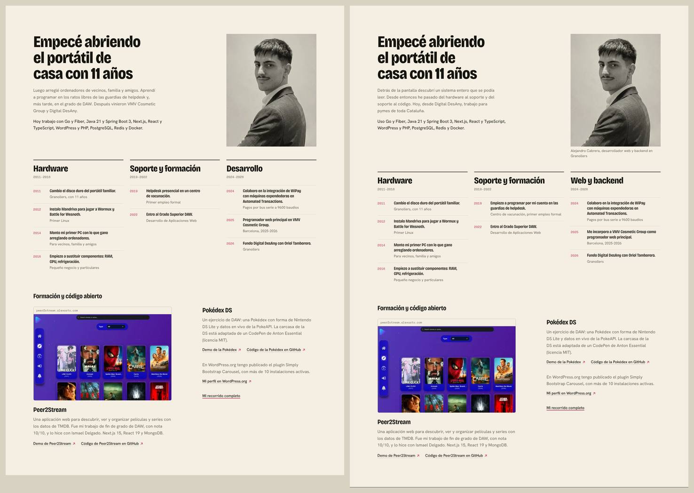 |

| Página Sobre mí, 1440 px | Recorrido, 1440 px |
|---|---|
| 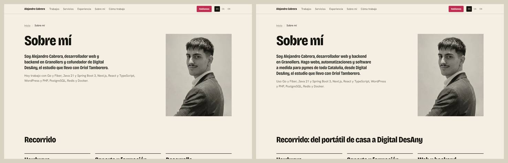 | 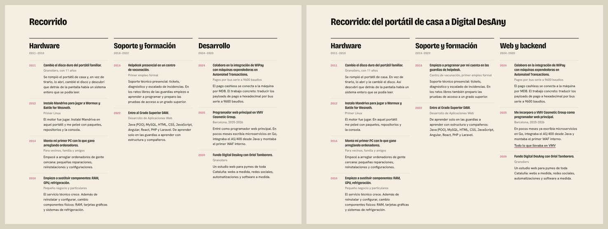 |

Qué cambia y por qué:

- **Cada hecho sale una vez por página, donde mejor se lee.** El resumen de la portada ya no repite lo que dicen los hitos justo debajo (vecinos, helpdesk, DAW, VMV, DesAny). Cuenta lo que la portada no enseña: lo que descubrí al abrir el portátil, el camino en una línea y para quién trabajo hoy.
- **El giro de la historia pasa a los títulos.** Empezar a programar en las guardias de helpdesk estaba escondido en un texto que la portada no muestra. Ahora es el título de 2019. Todos los títulos son acciones en primera persona, también el de VMV.
- **Los textos de los hitos no repiten su título** (Mandriva, VMV) y las frases largas se parten.
- **La entradilla de la página dice qué hago y para quién**, con las mismas palabras que el inicio, y el título de la sección cuenta el arco: "del portátil de casa a Digital DesAny".
- **Debajo de la foto de la portada** va un pie con nombre, oficio y lugar, las palabras del H1. El texto alternativo describe la foto en vez de decir "Retrato de".
- **El hito de 2025 enlaza a la página de VMV**, con la etiqueta que ya usa Experiencia ("Todo lo que llevaba en VMV"): la prueba al lado de lo que se afirma.
- **Fuera "Dónde encontrarme".** Repetía los mismos perfiles y el mismo correo que Contacto, que va justo después. Ahora la página acaba en Contacto.

18 cambios: 15 textos cambiados, un texto nuevo, un enlace nuevo y una sección quitada.

### `PAGES.about.lede` (T1, T10)

- **Antes:** Soy Alejandro Cabrera, desarrollador web y backend en Granollers y cofundador de Digital DesAny, el estudio que llevo con Oriol Tamborero.
- **Después:** Soy Alejandro Cabrera, desarrollador web y backend en Granollers. Hago webs, automatizaciones y software a medida para pymes de toda Cataluña, desde Digital DesAny, el estudio que llevo con Oriol Tamborero.
- **CA:** Sóc l'Alejandro Cabrera, desenvolupador web i backend a Granollers. Faig webs, automatitzacions i programari a mida per a pimes de tot Catalunya, des de Digital DesAny, l'estudi que porto amb l'Oriol Tamborero.
- **EN:** I'm Alejandro Cabrera, a web and backend developer in Granollers. I build websites, automations and custom software for small and medium businesses across Catalonia, through Digital DesAny, the studio I run with Oriol Tamborero.

### `SEO.about.description` (T13)

- **Antes:** De cambiar el disco duro del portátil familiar con 11 años a cofundar Digital DesAny. Mi recorrido, el Grado Superior DAW y cómo trabajo.
- **Después:** De cambiar el disco duro del portátil familiar con 11 años a cofundar Digital DesAny, donde hago webs y software a medida para pymes de toda Cataluña.
- **CA:** De canviar el disc dur del portàtil familiar amb 11 anys a cofundar Digital DesAny, on faig webs i programari a mida per a pimes de tot Catalunya.
- **EN:** From swapping the family laptop's hard drive at 11 to co-founding Digital DesAny, where I build websites and custom software for SMEs across Catalonia.

### `PAGES.about.sections.path` (T12)

- **Antes:** Recorrido
- **Después:** Recorrido: del portátil de casa a Digital DesAny
- **CA:** Recorregut: del portàtil de casa a Digital DesAny
- **EN:** My path: from the family laptop to Digital DesAny

### `DATA.about.description` (T2, T14)

- **Antes:** Luego arreglé ordenadores de vecinos, familia y amigos. Aprendí a programar en los ratos libres de las guardias de helpdesk y, más tarde, en el grado de DAW. Después vinieron VMV Cosmetic Group y Digital DesAny.
- **Después:** Detrás de la pantalla descubrí un sistema entero que se podía leer. Desde entonces he pasado del hardware al soporte y del soporte al código. Hoy, desde Digital DesAny, trabajo para pymes de toda Cataluña.
- **CA:** Darrere de la pantalla vaig descobrir un sistema sencer que es podia llegir. Des d'aleshores he passat del hardware al suport i del suport al codi. Avui, des de Digital DesAny, treballo per a pimes de tot Catalunya.
- **EN:** Behind the screen I found a whole system I could read. Since then I've moved from hardware to support, and from support to code. Today, through Digital DesAny, I work for small and medium businesses across Catalonia.

### `DATA.about.stack` (T14)

- **Antes:** Hoy trabajo con Go y Fiber, Java 21 y Spring Boot 3, Next.js, React y TypeScript, WordPress y PHP, PostgreSQL, Redis y Docker.
- **Después:** Uso Go y Fiber, Java 21 y Spring Boot 3, Next.js, React y TypeScript, WordPress y PHP, PostgreSQL, Redis y Docker.
- **CA:** Utilitzo Go i Fiber, Java 21 i Spring Boot 3, Next.js, React i TypeScript, WordPress i PHP, PostgreSQL, Redis i Docker.
- **EN:** I use Go and Fiber, Java 21 and Spring Boot 3, Next.js, React and TypeScript, WordPress and PHP, PostgreSQL, Redis and Docker.

### `DATA.about.portrait.alt` (T8)

- **Antes:** Retrato de Alejandro Cabrera
- **Después:** Alejandro Cabrera, de medio lado, con americana oscura y camisa clara, sonríe a cámara
- **CA:** L'Alejandro Cabrera, girat de costat, amb americana fosca i camisa clara, somriu a la càmera
- **EN:** Alejandro Cabrera, turned side-on in a dark jacket and light shirt, smiles at the camera

### `DATA.about.portrait.caption` (T10)

- **Antes:** (no existía)
- **Después:** Alejandro Cabrera, desarrollador web y backend en Granollers
- **CA:** Alejandro Cabrera, desenvolupador web i backend a Granollers
- **EN:** Alejandro Cabrera, web and backend developer in Granollers

### `DATA.about.stages[2].name` (T8, T12)

- **Antes:** Desarrollo
- **Después:** Web y backend
- **CA:** Web i backend
- **EN:** Web and backend

### `DATA.about.entries[0].body` (T8, T14)

- **Antes:** Se rompió el portátil de casa y, en vez de tirarlo, lo abrí, cambié el disco y descubrí que detrás de la pantalla había un sistema entero que se podía leer.
- **Después:** Se rompió el portátil de casa. En vez de tirarlo, lo abrí y le cambié el disco. Así descubrí que detrás de la pantalla había un sistema entero que se podía leer.
- **CA:** Es va trencar el portàtil de casa. En lloc de llençar-lo, el vaig obrir i li vaig canviar el disc. Així vaig descobrir que darrere de la pantalla hi havia un sistema sencer que es podia llegir.
- **EN:** The family laptop broke. Instead of throwing it out, I opened it up and swapped the drive. That's how I found a whole system behind the screen that I could read.

### `DATA.about.entries[1].body` (T14)

- **Antes:** El motor fue jugar. Instalé Mandriva en aquel portátil y me peleé con paquetes, repositorios y la consola.
- **Después:** El motor fue jugar. En aquel portátil me peleé con paquetes, repositorios y la consola.
- **CA:** El motor va ser jugar. En aquell portàtil em vaig barallar amb paquets, repositoris i la consola.
- **EN:** Gaming was the driver. On that laptop I fought with packages, repositories and the terminal.

### `DATA.about.entries[4].title` (T2, T12)

- **Antes:** Helpdesk presencial en un centro de vacunación.
- **Después:** Empiezo a programar por mi cuenta en las guardias de helpdesk.
- **CA:** Començo a programar pel meu compte a les guàrdies de helpdesk.
- **EN:** I start teaching myself to code on helpdesk shifts.

### `DATA.about.entries[4].place` (T10)

- **Antes:** Primer empleo formal
- **Después:** Centro de vacunación, primer empleo formal
- **CA:** Centre de vacunació, primera feina formal
- **EN:** Vaccination centre, first formal job

### `DATA.about.entries[4].body` (T14)

- **Antes:** Soporte técnico presencial: tickets, diagnóstico y escalado de incidencias. En los ratos libres de las guardias empiezo a aprender a programar y preparo las pruebas de acceso a un grado superior.
- **Después:** Soporte técnico presencial: tickets, diagnóstico y escalado de incidencias. En los ratos libres también preparo las pruebas de acceso a un grado superior.
- **CA:** Suport tècnic presencial: tiquets, diagnòstic i escalat d'incidències. A les estones lliures també preparo les proves d'accés a un grau superior.
- **EN:** On-site tech support: tickets, diagnosis and escalation. In the quiet hours I also prepare for the entrance exams to a higher vocational course.

### `DATA.about.entries[5].body` (T2)

- **Antes:** Java (POO), MySQL, HTML, CSS, JavaScript, Angular, React, PHP y Laravel. De aprender solo en las guardias a aprender con estructura y compañeros.
- **Después:** De aprender solo en las guardias a aprender con estructura y compañeros: Java (POO), MySQL, HTML, CSS, JavaScript, Angular, React, PHP y Laravel.
- **CA:** D'aprendre sol a les guàrdies a aprendre amb estructura i companys: Java (POO), MySQL, HTML, CSS, JavaScript, Angular, React, PHP i Laravel.
- **EN:** From learning alone on shift to learning with structure and classmates: Java (OOP), MySQL, HTML, CSS, JavaScript, Angular, React, PHP and Laravel.

### `DATA.about.entries[7].title` (T12)

- **Antes:** Programador web principal en VMV Cosmetic Group.
- **Después:** Me incorporo a VMV Cosmetic Group como programador web principal.
- **CA:** M'incorporo a VMV Cosmetic Group com a programador web principal.
- **EN:** I join VMV Cosmetic Group as lead web developer.

### `DATA.about.entries[7].body` (T14)

- **Antes:** Entré como programador web principal. En pocos meses escribía microservicios en Go, integraba el AS/400 desde Java y montaba el primer WAF interno.
- **Después:** En pocos meses ya escribía microservicios en Go, integraba el AS/400 desde Java y montaba el primer WAF interno.
- **CA:** En pocs mesos ja escrivia microserveis en Go, integrava l'AS/400 des de Java i muntava el primer WAF intern.
- **EN:** Within months I was already writing Go microservices, integrating the AS/400 from Java and building the first internal WAF.

### `PAGES.about.sections.profiles`, la sección con perfiles y correo (T14)

- **Antes:** Dónde encontrarme
- **Después:** (se quita)

### Enlace del hito de 2025 a la página de VMV (T7, T9)

- **Antes:** (no existía)
- **Después:** Todo lo que llevaba en VMV
- **CA:** Tot el que portava a VMV
- **EN:** Everything I looked after at VMV

Reutiliza `DATA.experience.vmv.more` y lleva a `/proyectos/vmv-cosmetic-group` (`/ca/projectes/vmv-cosmetic-group`, `/en/projects/vmv-cosmetic-group`). Solo en la página Sobre mí; en la portada los hitos no llevan texto.

## Respuestas desde digitaldesany.com (23 de octubre)

Alejandro dice que casi todas las preguntas abiertas se contestan con digitaldesany.com. Se leyeron sus 70 páginas, se contestaron 24 preguntas con cita y URL (un verificador por grupo) y se aplicó lo que el estudio publica, sin precios ni forma de pago. Después, cuatro revisores (hechos, reglas e idiomas, marketing, y código y accesibilidad) y un verificador por revisor: se confirmaron 37 de 45 hallazgos y se arreglaron todos. Antes (izquierda, la web publicada) y después (derecha), en castellano:

| Contacto, 1440 px |
|---|
| 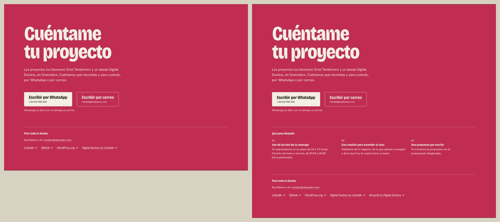 |

| Las cuatro partes, `/desarrollo-web`, 1440 px | Cómo va un proyecto (nuevo), 1440 px |
|---|---|
| 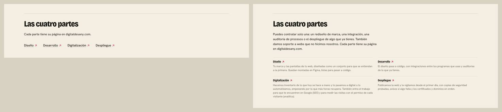 | 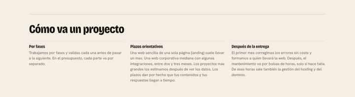 |

| Servicios, 1440 px |
|---|
| 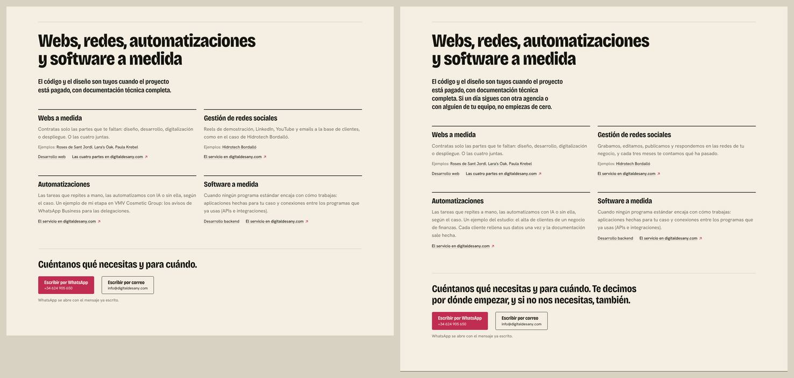 |

Además de los textos de abajo:

- La tarjeta de Paula Krebel enlaza a paulakrebel.com.
- Las cuatro partes de `/desarrollo-web` pasan de una fila de enlaces a una lista con lo que incluye cada una. Su título es el enlace a su página en digitaldesany.com, y los lectores de pantalla oyen el dominio.
- JSON-LD: el estudio lleva teléfono, `contactPoint` (horario, castellano y catalán) y su perfil de Google en `sameAs`. El nodo de Alejandro añade a su `sameAs` el `@id` con el que lo nombra digitaldesany.com. El premio en el JSON-LD tiene como sujeto el proyecto: "Neibr, uno de los tres proyectos ganadores".

30 textos cambiados o nuevos.

### `DATA.hero.proof[3].text` (T8, T9)

- **Antes:** Neibr fue uno de los proyectos ganadores de los Santander X Spain Awards 2026 (UVic)
- **Después:** Neibr fue uno de los tres ganadores de los Santander X Spain Awards 2026 (UVic)
- **CA:** Neibr va ser un dels tres guanyadors dels Santander X Spain Awards 2026 (UVic)
- **EN:** Neibr was one of the three winners of the Santander X Spain Awards 2026 (UVic)

### `DATA.work.cases[1].description` (T8, T11)

- **Antes:** Portfolio de storyboard y concept art, con un CMS hecho sobre un sistema de bloques propio.
- **Después:** Portfolio de storyboard y concept art que Lara actualiza sola, sin tocar código, con un CMS hecho sobre un sistema de bloques propio.
- **CA:** Portfolio de storyboard i concept art que la Lara actualitza sola, sense tocar codi, amb un CMS fet sobre un sistema de blocs propi.
- **EN:** Storyboard and concept art portfolio that Lara updates herself, without touching code, with a CMS built on its own block system.

### `DATA.work.cases[2].description` (T8, T11)

- **Antes:** Portfolio trilingüe de ilustración infantil y juvenil, con diseño de marca y un sistema de diseño.
- **Después:** Portfolio de ilustración infantil y juvenil en catalán, castellano e inglés, con diseño de marca y un sistema de diseño.
- **CA:** Portfolio d'il·lustració infantil i juvenil en català, castellà i anglès, amb disseny de marca i un sistema de disseny.
- **EN:** Children's and young adult illustration portfolio in Catalan, Spanish and English, with brand design and a design system.

### `DATA.work.cases[2].shot.alt` (T8, T11)

- **Antes:** Portada de la web de Paula Krebel, portfolio de ilustración
- **Después:** Portada de paulakrebel.com, el portfolio de Paula Krebel
- **CA:** Portada de paulakrebel.com, el portfolio de la Paula Krebel
- **EN:** Home page of paulakrebel.com, Paula Krebel's portfolio

### `DATA.services.ownership` (T5)

- **Antes:** El código y el diseño son tuyos cuando el proyecto está pagado, con documentación técnica completa.
- **Después:** El código y el diseño son tuyos cuando el proyecto está pagado, con documentación técnica completa. Si un día sigues con otra agencia o con alguien de tu equipo, no empiezas de cero.
- **CA:** El codi i el disseny són teus quan el projecte està pagat, amb documentació tècnica completa. Si un dia continues amb una altra agència o amb algú del teu equip, no comences de zero.
- **EN:** The code and the design are yours once the project is paid for, with full technical documentation. If you ever switch to another agency or to someone on your own team, you don't start from scratch.

### `DATA.services.items[1].text` (T3, T4)

- **Antes:** Reels de demostración, LinkedIn, YouTube y emails a la base de clientes, como en el caso de Hidrotech Bordalló.
- **Después:** Grabamos, editamos, publicamos y respondemos en las redes de tu negocio, y cada tres meses te contamos qué ha pasado.
- **CA:** Gravem, editem, publiquem i responem a les xarxes del teu negoci, i cada tres mesos t'expliquem què ha passat.
- **EN:** We film, edit, post and reply on your business's social media, and every three months we tell you how it went.

### `DATA.services.items[2].text` (T3, T4)

- **Antes:** Las tareas que repites a mano, las automatizamos con IA o sin ella, según el caso. Un ejemplo de mi etapa en VMV Cosmetic Group: los avisos de WhatsApp Business para las delegaciones.
- **Después:** Las tareas que repites a mano, las automatizamos con IA o sin ella, según el caso. Un ejemplo del estudio: el alta de clientes de un negocio de finanzas. Cada cliente rellena sus datos una vez y la documentación sale hecha.
- **CA:** Les tasques que repeteixes a mà, les automatitzem amb IA o sense, segons el cas. Un exemple de l'estudi: l'alta de clients d'un negoci de finances. Cada client omple les seves dades un cop i la documentació surt feta.
- **EN:** We automate the tasks you repeat by hand, with or without AI, depending on the job. One example from the studio: client sign-up at a finance business. Each client fills in their details once and the paperwork comes out ready.

### `DATA.services.cta.line` (T6)

- **Antes:** Cuéntanos qué necesitas y para cuándo.
- **Después:** Cuéntanos qué necesitas y para cuándo. Te decimos por dónde empezar, y si no nos necesitas, también.
- **CA:** Explica'ns què necessites i per a quan. Et diem per on començar, i si no ens necessites, també.
- **EN:** Tell us what you need and by when. We'll tell you where to start, and if you don't need us, we'll say so.

### `DATA.experience.neibr.award` (T8, T9)

- **Antes:** Fue uno de los proyectos ganadores de los Santander X Spain Awards 2026 (UVic).
- **Después:** Fue uno de los tres ganadores de los Santander X Spain Awards 2026 (UVic).
- **CA:** Va ser un dels tres guanyadors dels Santander X Spain Awards 2026 (UVic).
- **EN:** It was one of the three winners of the Santander X Spain Awards 2026 (UVic).

### `DATA.about.entries[8].body` (T10, T14)

- **Antes:** Un estudio web para pymes de toda Cataluña: webs a medida, redes sociales, automatizaciones y software a medida.
- **Después:** Dirijo la tecnología del estudio y monté toda su infraestructura, de los servidores a los despliegues. Oriol dirige la primera reunión y prepara las propuestas.
- **CA:** Dirigeixo la tecnologia de l'estudi i vaig muntar tota la seva infraestructura, dels servidors als desplegaments. L'Oriol dirigeix la primera reunió i prepara les propostes.
- **EN:** I lead the studio's technology and set up all of its infrastructure, from the servers to the deployments. Oriol leads the first meeting and prepares the proposals.

### `DATA.contact.nextLabel` (T6, T10)

- **Antes:** (no existía)
- **Después:** Qué pasa después
- **CA:** Què passa després
- **EN:** What happens next

### `DATA.contact.next[0].title` (T6, T10)

- **Antes:** (no existía)
- **Después:** Uno de los dos lee tu mensaje
- **CA:** Un dels dos llegeix el teu missatge
- **EN:** One of us reads your message

### `DATA.contact.next[0].text` (T6, T10)

- **Antes:** (no existía)
- **Después:** Te respondemos en un plazo de 24 a 72 horas. Horario: de lunes a viernes, de 09:00 a 20:00 (hora peninsular).
- **CA:** Et responem en un termini de 24 a 72 hores. Horari: de dilluns a divendres, de 09:00 a 20:00 (hora peninsular).
- **EN:** We reply within 24 to 72 hours. Hours: Monday to Friday, 09:00 to 20:00 (Spain time).

### `DATA.contact.next[1].title` (T6, T10)

- **Antes:** (no existía)
- **Después:** Una reunión para entender el caso
- **CA:** Una reunió per entendre el cas
- **EN:** A meeting to understand your case

### `DATA.contact.next[1].text` (T6, T10)

- **Antes:** (no existía)
- **Después:** Hablamos de tu negocio, de lo que quieres conseguir y de lo que hoy te cuesta hacer a mano.
- **CA:** Parlem del teu negoci, del que vols aconseguir i del que avui et costa fer a mà.
- **EN:** We talk about your business, what you want to achieve and what you find hard to do by hand today.

### `DATA.contact.next[2].title` (T6, T10)

- **Antes:** (no existía)
- **Después:** Una propuesta por escrito
- **CA:** Una proposta per escrit
- **EN:** A written proposal

### `DATA.contact.next[2].text` (T6, T10)

- **Antes:** (no existía)
- **Después:** Te enviamos la propuesta con el presupuesto desglosado.
- **CA:** T'enviem la proposta amb el pressupost desglossat.
- **EN:** We send you the proposal with an itemised quote.

### `DATA.contact.desanyProfile.label` (T6, T10)

- **Antes:** (no existía)
- **Después:** Mi perfil en Digital DesAny
- **CA:** El meu perfil a Digital DesAny
- **EN:** My profile at Digital DesAny

### `PAGES.web.sections.project` (T6, T8)

- **Antes:** (no existía)
- **Después:** Cómo va un proyecto
- **CA:** Com va un projecte
- **EN:** How a project works

### `PAGES.web.parts[0].text` (T3, T4)

- **Antes:** (no existía)
- **Después:** Tu marca y las pantallas de tu web, diseñadas como un conjunto para que se entiendan a la primera. Quedan montadas en Figma, listas para pasar a código.
- **CA:** La teva marca i les pantalles del teu web, dissenyades com un conjunt perquè s'entenguin a la primera. Queden muntades a Figma, a punt per passar a codi.
- **EN:** Your brand and your website's screens, designed as one set so they make sense at first glance. They are built in Figma, ready to become code.

### `PAGES.web.parts[1].text` (T3, T4)

- **Antes:** (no existía)
- **Después:** El diseño pasa a código, con integraciones entre los programas que usas y auditorías de lo que ya tienes.
- **CA:** El disseny passa a codi, amb integracions entre els programes que fas servir i auditories del que ja tens.
- **EN:** The design becomes code, with integrations between the programs you use and audits of what you already have.

### `PAGES.web.parts[2].text` (T3, T4)

- **Antes:** (no existía)
- **Después:** Hacemos inventario de lo que hoy se hace a mano y lo pasamos a digital o lo automatizamos, empezando por lo que más horas recupera. También entra el trabajo para que te encuentren en Google (SEO) y para medir las visitas con el permiso de cada visitante (analítica).
- **CA:** Fem inventari del que avui es fa a mà i ho passem a digital o ho automatitzem, començant pel que recupera més hores. També hi entra la feina perquè et trobin a Google (SEO) i per mesurar les visites amb el permís de cada visitant (analítica).
- **EN:** We list what is still done by hand and move it to digital or automate it, starting with what saves the most hours. This part also covers the work to get you found on Google (SEO) and to measure visits with each visitor's consent (analytics).

### `PAGES.web.parts[3].text` (T3, T4)

- **Antes:** (no existía)
- **Después:** Publicamos la web y la vigilamos desde el primer día, con copias de seguridad probadas, avisos si algo falla y los certificados y dominios en orden.
- **CA:** Publiquem el web i el vigilem des del primer dia, amb còpies de seguretat provades, avisos si alguna cosa falla i els certificats i dominis en ordre.
- **EN:** We publish the website and monitor it from day one, with tested backups, alerts when something fails, and certificates and domains kept in order.

### `PAGES.web.partsNote` (T3, T4)

- **Antes:** Cada parte tiene su página en digitaldesany.com.
- **Después:** Puedes contratar solo una: un rediseño de marca, una integración, una auditoría de procesos o el despliegue de algo que ya tienes. También damos soporte a webs que no hicimos nosotros. Cada parte tiene su página en digitaldesany.com.
- **CA:** Pots contractar-ne només una: un redisseny de marca, una integració, una auditoria de processos o el desplegament d'alguna cosa que ja tens. També donem suport a webs que no hem fet nosaltres. Cada part té la seva pàgina a digitaldesany.com.
- **EN:** You can hire just one: a brand redesign, an integration, a process audit, or deploying something you already have. We also support websites we didn't build. Each part has its own page at digitaldesany.com.

### `PAGES.web.project[0].title` (T6, T8)

- **Antes:** (no existía)
- **Después:** Por fases
- **CA:** Per fases
- **EN:** In phases

### `PAGES.web.project[0].text` (T6, T8)

- **Antes:** (no existía)
- **Después:** Trabajamos por fases y validas cada una antes de pasar a la siguiente. En el presupuesto, cada parte va por separado.
- **CA:** Treballem per fases i en valides cadascuna abans de passar a la següent. Al pressupost, cada part va per separat.
- **EN:** We work in phases, and you approve each one before we move on to the next. In the quote, each part is listed separately.

### `PAGES.web.project[1].title` (T6, T8)

- **Antes:** (no existía)
- **Después:** Plazos orientativos
- **CA:** Terminis orientatius
- **EN:** Indicative timelines

### `PAGES.web.project[1].text` (T6, T8)

- **Antes:** (no existía)
- **Después:** Una web sencilla de una sola página (landing) suele llevar un mes. Una web corporativa mediana con algunas integraciones, entre dos y tres meses. Los proyectos más grandes los estimamos después de ver los datos. Los plazos dan por hecho que tus contenidos y tus respuestas llegan a tiempo.
- **CA:** Un web senzill d'una sola pàgina (landing) sol trigar un mes. Un web corporatiu mitjà amb algunes integracions, entre dos i tres mesos. Els projectes més grans els estimem després de veure les dades. Els terminis donen per fet que els teus continguts i les teves respostes arriben a temps.
- **EN:** A simple one-page website (landing page) usually takes a month. A mid-sized company website with a few integrations, two to three months. We estimate bigger projects once we have seen the data. These timelines assume your content and feedback arrive on time.

### `PAGES.web.project[2].title` (T6, T8)

- **Antes:** (no existía)
- **Después:** Después de la entrega
- **CA:** Després del lliurament
- **EN:** After delivery

### `PAGES.web.project[2].text` (T6, T8)

- **Antes:** (no existía)
- **Después:** El primer mes corregimos los errores sin coste y formamos a quien llevará la web. Después, el mantenimiento va por bolsas de horas, solo si hace falta. De esas horas sale también la gestión del hosting y del dominio.
- **CA:** El primer mes corregim els errors sense cost i formem qui portarà el web. Després, el manteniment va per bosses d'hores, només si cal. D'aquestes hores també surt la gestió de l'allotjament i del domini.
- **EN:** In the first month we fix bugs at no cost and train whoever will run the website. After that, maintenance comes in blocks of hours, only when you need it. Hosting and domain management also come out of those hours.
